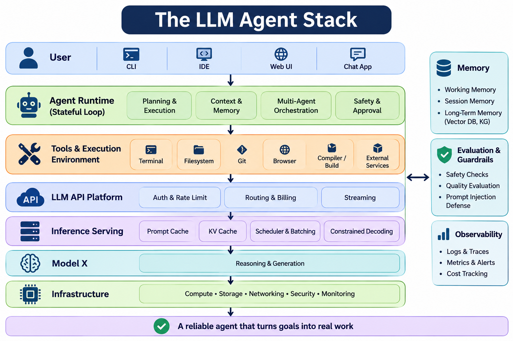

An LLM agent is more than a model with a long prompt. It is a software system that combines model intelligence, inference infrastructure, context management, orchestration, and tools to turn a user objective into completed work.

The LLM (Model X) provides the core intelligence—reasoning, coding, language understanding, and generation. The inference serving layer makes it efficient through batching, scheduling, GPU memory management, optimized kernels, KV cache, and prompt caching. The API platform exposes these capabilities through authentication, rate limiting, billing, routing, and streaming.

The agent harness turns model inference into ongoing work. It maintains the execution loop, tracks tasks, invokes tools, handles failures, enforces policies, and decides when to continue or stop. Its fundamental cycle is Plan → Act → Observe → Repeat.

To operate effectively, agents also need context engineering and memory. The context manager selects what the model needs at each step, while memory spans working state, session history, and persistent knowledge. Retrieval, summarization, compaction, and sub-agent delegation help preserve useful information while controlling context size, cost, and noise.

Tools and execution environments connect the agent to the real world—terminals, filesystems, Git, compilers, test runners, browsers, and external services. The model proposes actions; the harness executes them and returns results.

Reliable agents require structured outputs, safety, and control. Schema-constrained outputs improve tool-call reliability, while permissions, human approval gates, and prompt-injection defenses prevent unsafe or unauthorized actions. Multi-agent orchestration can further delegate tasks to specialized agents or different models to improve efficiency.

Finally, evaluation and observability measure task success, execution quality, safety, latency, token usage, and cost. Infrastructure—including compute, storage, networking, security, and deployment—supports the entire system.

The fundamental distinction is that a model call produces an inference result, while an agent execution pursues an objective over multiple steps. The model provides intelligence; the serving stack makes it efficient; the agent harness makes it persistent and actionable; and tools connect it to reality. Together, these layers turn token generation into meaningful work.
